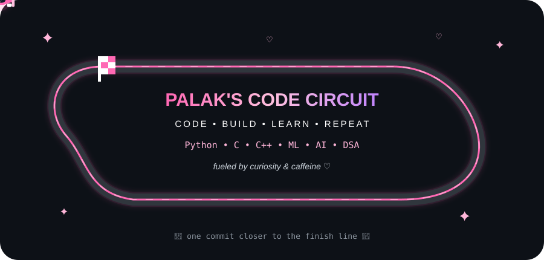

<!-- 🎀 GitHub Profile README | Palak0026 🎀 -->

# 🎀 Hi, I'm Palak! 🌷

### ✨ B.Tech Student • Developer • ML Enthusiast ✨

💗 Learning, building & turning ideas into code 💗

---

## 🌷 About Me

🎓 B.Tech student exploring the world of **Computer Science**

💻 I love working with **Python, C, C++, Machine Learning & Deep Learning**

🤖 Currently learning more about **Artificial Intelligence & Machine Learning**

🌐 Exploring **Computer Networks, Operating Systems & Algorithms**

🧠 Interested in building projects that solve **real-world problems**

🏎️ Also bringing a little speed, creativity & personality into my code

🎀 My philosophy:

> `code • create • learn • repeat ♡`

---

## 💕 Tech Stack

### 💻 Languages

### 🤖 Machine Learning & Data

### 🛠️ Tools

---

## 💗 What I'm Working On

🌸 **Machine Learning**
- Classification & Regression
- Neural Networks
- Deep Learning
- Time-Series Forecasting

🌸 **Data Structures & Algorithms**
- Searching & Sorting
- Dynamic Programming
- Matrix Chain Multiplication
- Strassen's Matrix Multiplication

🌸 **Computer Networks**
- Cisco Packet Tracer
- Network Topologies
- TCP/IP & OSI Model
- Routing & Switching

🌸 **Operating Systems**
- Process Management
- CPU Scheduling
- Memory Management

---

## 🎀 Featured Projects

### 🫀 Heart Disease Prediction

> Machine learning / deep learning model for heart disease prediction.

`Python` `Pandas` `Neural Networks` `Machine Learning`

### 📈 Store Sales Forecasting

> Time-series machine learning model for predicting future store sales.

`Python` `LightGBM` `Pandas` `Time Series`

### 🌐 Network Topology Simulation

> Designed and tested different network topologies using Cisco Packet Tracer.

`Networking` `Cisco Packet Tracer` `TCP/IP`

### 🧠 Algorithm Implementations

> Implementations and analysis of important Data Structures & Algorithms.

`C` `C++` `Algorithms` `Dynamic Programming`

---

# 🏎️ Palak's Code Circuit

### 🎀 Racing through bugs, commits & caffeine 🏁

`CODE` • `BUILD` • `LEARN` • `REPEAT`

---

## 📊 GitHub Stats

---

## 🌸 Contribution Streak

---

## 💌 Connect With Me

---

### 🌷 Thanks for visiting my little corner of GitHub 🌷

✨ *building one project at a time* ✨

### 🎀 `</ dream • code • create >` 🎀

♡ ♡ ♡

